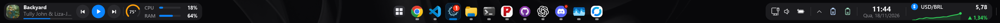
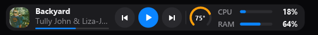
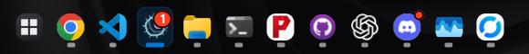
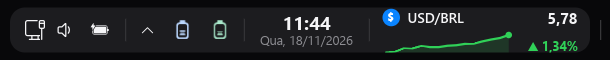

# WindowsBar

Uma barra de tarefas com widgets para o Windows 11, inspirada no [Luma Bar](https://lumabar.xyz/). Substitui a barra do Windows por um dock com seus apps, relógio, clima, música tocando, uso de CPU/RAM, bandeja do sistema e o que mais você quiser montar.

Feito com [Tarve](https://tarve.dev) 0.13.2: interface desenhada nativamente, sem navegador embutido.



[Instalação](#instalação) · [Como usar](#como-usar) · [Widgets](#widgets-incluídos) · [Configurações](#configurações) · [Criando widgets](#criando-widgets)

### Um olhar de perto

**Esquerda — tocando agora, clima e CPU/RAM**



**Centro — Iniciar e apps**, com indicador de janela aberta e contador de notificações vindo do próprio app



**Direita — rede, volume, bateria, bandeja, relógio e um widget de cotação**



## Instalação

1. Baixe o `WindowsBar-Setup-<versão>-win32-x64.exe` em [Releases](https://github.com/omarcosr/windows-bar/releases/latest).
2. Execute. A instalação é por usuário (não pede administrador) e vai para `%LOCALAPPDATA%\Programs\WindowsBar`.
3. Escolha se quer atalho na área de trabalho e se o WindowsBar deve iniciar com o Windows.

> O executável ainda não é assinado digitalmente, então o Windows SmartScreen pode avisar na primeira execução. Clique em **Mais informações → Executar assim mesmo**.

Prefere sem instalar? Baixe o `.zip` da mesma página, extraia e rode `WindowsBar.exe` (essa versão não se atualiza sozinha).

Requisitos: Windows 11, 64 bits.

## Como usar

| Ação | Onde |
| --- | --- |
| Abrir um app / alternar janelas | Clique no ícone. Com várias janelas abertas, aparece o preview para escolher. |
| Menu do app (fixar, fechar, abrir local do arquivo) | Clique direito no ícone. |
| Reordenar apps | Arraste o ícone. |
| Ver as janelas de um app | Passe o mouse no ícone. |
| Menu Iniciar | Clique no botão do Windows; clique direito abre o menu de sistema (como o Win+X). |
| Adicionar, remover e reordenar widgets | Clique direito em qualquer área vazia da barra → **Widgets…**. |
| Configurações da barra | Clique direito em uma área vazia → **Configurações da barra…**. |
| Menu de um widget (mover, remover) | Clique direito no widget. |
| Fechar o WindowsBar | Clique direito em uma área vazia → **Sair do WindowsBar**. |

### Widgets incluídos

- **Apps**: fixados e abertos, com preview das janelas e os contadores de notificação dos apps.
- **Iniciar**: abre o menu Iniciar.
- **Relógio e clima**: hora, dia e temperatura.
- **Tocando agora**: música de qualquer player (Spotify, navegador, Apple Music) com controles.
- **CPU e RAM**: uso ao vivo.
- **Bandeja do sistema**: ícones dos apps em segundo plano.
- **Rede, volume e bateria**, **Idioma do teclado** e **Relógio da barra**: os mesmos itens do canto da barra do Windows.
- **Receita (Stripe)**: receita dos últimos 30 dias. Sem chave mostra dados de exemplo; para usar seus dados, coloque uma chave restrita (somente leitura) do Stripe em `stripeKey` no arquivo de configuração.

### Configurações

Em **Configurações** você ajusta:

- **Aparência**: estilo (flutuante ou barra inteira), altura, cantos, opacidade e espaço entre widgets.
- **Posição**: alinhamento, distância da borda e reserva de espaço para as janelas maximizadas.
- **Cor**: o fundo da barra pode seguir a cor do app aberto, com animação.
- **Efeito ao passar o mouse**: tipo, intensidade, velocidade e cor do brilho.
- **Ícones e janelas**: tamanho dos ícones, indicador de app aberto, ícones empilhados, comportamento do clique e preview.
- **Sistema**: idioma (por padrão segue o Windows: português se o Windows estiver em português, senão inglês), iniciar com o Windows, atualizações automáticas e restaurar os padrões.

A configuração fica em `%APPDATA%\windows-bar\config.json`.

## Atualizações

O WindowsBar procura novas versões um minuto depois de abrir e a cada 6 horas. Na maioria das versões o download é só o código do app (algumas centenas de KB), sem baixar o executável inteiro de novo. Com **Baixar atualizações automaticamente** ligado, a nova versão é baixada e verificada (assinatura digital) em segundo plano e instalada quando você clicar em **Reiniciar e atualizar** em **Configurações da barra → Sistema**. Também dá para procurar na hora pelo ícone do WindowsBar na bandeja → **Procurar atualizações**.

## Desinstalar

**Configurações do Windows → Apps → Aplicativos instalados → WindowsBar → Desinstalar.** A barra do Windows volta automaticamente.

Se por algum motivo a barra do Windows não reaparecer (por exemplo, depois de o processo ser encerrado à força), reinicie o Explorer pelo Gerenciador de Tarefas ou reabra o WindowsBar e feche-o pelo menu.

## Problemas e sugestões

Abra uma [issue](https://github.com/omarcosr/windows-bar/issues) com a versão do Windows, a versão do WindowsBar (em **Configurações da barra → Sistema**) e, se possível, um print.

---

## Criando widgets

Cada widget é um arquivo `.tsx` com `defineWidget()`. Ainda não há carregamento de plugins externos: widgets novos entram no app por pull request.

### Ambiente

Requer Windows 11 x64 e [Bun](https://bun.sh) 1.3+ para instalar dependências e executar o CLI do Tarve (inclusive ao compilar para outro runtime). O executável distribuído inclui o runtime: o usuário final não precisa instalar Bun, Node ou txiki.

| Runtime do app (Tarve 0.13.2) | Desenvolvimento | Build | Requisito adicional |
| --- | --- | --- | --- |
| Bun | `bun run dev` / `bun run dev:bun` | `bun run build:bun` | Bun no PATH |
| txiki.js | Não suportado pelo `tarve dev`; use Bun | `bun run build` / `bun run build:txiki` (padrão) | `tjs` no PATH ou `TARVE_TXIKI` apontando para o executável |
| Node | `bun run dev:node` | `bun run build:node` | Node 26.10+ no PATH |

Instale txiki com `winget install Saghul.TxikiJS` e reabra o terminal. O runner de release usa txiki 26.6.0, versão exercitada nos testes. Cada build alternativo fica em `dist/bun` ou `dist/node`; o padrão txiki fica em `dist`. Também é possível usar `bunx tarve build src/main.tsx --runtime bun|node|txiki --outfile <arquivo.exe>` (escolha um runtime).

**Suporte nativo em 0.13.2:** `CFunction` usa `pointerFunction` do Tarve nos três runtimes. Volume Core Audio por COM, ícones via IImageList e Aero Peek por ordinal não são mais indisponíveis por falta de chamadas a ponteiros crus no txiki/Node. Isso comprova a disponibilidade da ponte, não a aparência ou interação desses recursos. Node continua exigindo FFI experimental (`--experimental-ffi` na execução direta; o exe já habilita o recurso).

**Resultados automatizados:** txiki, Bun, Node e `bun run dev` passaram nos modos flutuante e completo: reserva de área útil, ocultação do Explorer, `--quit` e restauração após saída normal ou kill, sem recuperação emergencial. `--autostart on/off` passou nos três exes; `--update` foi somente encaminhamento para feed indisponível, não instalação real.

**Limitações restantes:**
- **AppBar:** a reserva do dock usa `app.appBar(edge, { size, overlap })` (Tarve 0.13.3+). Só o estado da barra do Explorer (`ABM_GETSTATE`/`ABM_SETSTATE`) continua via Win32, encaminhado ao Explorer quando o tray host está ativo.
- **gap do Tarve — shim txiki:** o `Buffer` não implementa UTF-16LE; o adaptador local `encodeWide`/`decodeWide` continua necessário. `spawn` com `windowsHide` sem `detached` derruba o processo (0xC0000005), então `output()` usa `CreateProcessW` próprio. (`process.pid` e o `spawn` detached já vêm do Tarve.)
- **gap do Tarve — APIs específicas do Windows:** thumbnails DWM, Aero Peek e exclusão do preview do Peek continuam via FFI, não por uma API de alto nível do Tarve.
- **Validação pendente, não gap comprovado do Tarve:** aparência e interações da GUI (incluindo volume, ícones, Peek, bandeja, badges e seleção de thumbnails), shell-events, fullscreen, multimonitor e atualização real/entre runtimes ainda requerem homologação. `DockVisible=false` nos ensaios não permite aprovar a apresentação.

Build/release aprovado não equivale a homologação para uso diário. Evidências e checklist em [STEP7-RUNTIME-TESTS.md](STEP7-RUNTIME-TESTS.md#tarve-0132).

```powershell
git clone https://github.com/omarcosr/windows-bar
cd windows-bar
bun install
bun run dev                 # roda o dock e recarrega ao salvar
bun start -- --widgets      # roda e abre a galeria de widgets
bun run typecheck
```

Só roda um WindowsBar por vez: com uma cópia instalada aberta, a segunda execução apenas abre a galeria da primeira, então feche a instalada (clique direito na barra → **Sair do WindowsBar**) antes de desenvolver.

### Um widget mínimo

`src/widgets/builtin/counter.tsx`:

```tsx
import { Text, store } from "@tarve/core";
import { ui } from "../../theme";
import { Tile } from "../ui";
import { defineWidget } from "../types";

export default defineWidget({
  type: "counter",                  // id único, salvo na configuração
  name: "Contador",                 // nome na galeria
  description: "Conta cliques.",
  category: "productivity",         // clock | apps | system | media | finance | productivity
  defaultConfig: { step: 1 },       // config por instância
  setup(ctx) {
    const state = store({ count: 0 });   // store: mudanças redesenham o widget
    ctx.every(60_000, () => {});         // polling, cancelado quando o widget sai da barra
    ctx.onDispose(() => {});             // qualquer outra limpeza
    return state;
  },
  View({ state, ctx, preview }) {
    return (
      <Tile width={90} onClick={() => (state.count += ctx.config.step)}>
        <Text size={16} weight={700} color={ui.text}>{String(state.count)}</Text>
      </Tile>
    );
  },
  menu({ state, ctx }) {
    // Itens próprios do clique direito; o dock acrescenta mover, widgets e remover.
    return [[{ label: "Zerar", icon: "x", onSelect: () => (state.count = 0) }]];
  },
});
```

E registre em `src/widgets/builtin/index.ts`:

```ts
import counter from "./counter";
// ...
for (const widget of [clockWeather, start, apps, /* ... */, counter]) registerWidget(widget);
```

### API

| | |
| --- | --- |
| `setup(ctx)` | Roda uma vez por instância na barra (dois relógios têm estado e config separados). Retorne um `store`. |
| `View({ state, ctx, preview })` | Desenha o widget. `preview` é `true` quando ele aparece na galeria: evite efeitos colaterais ali. |
| `menu({ state, ctx })` | Opcional. Seções de itens `{ label, icon?, danger?, onSelect }` do clique direito. |
| `ctx.config` | Config salva da instância (reativa). Depois de alterar, chame `ctx.save()`. |
| `ctx.every(ms, fn)` | Roda `fn` agora e a cada `ms` enquanto o widget está montado. Erros são registrados, não lançados. |
| `ctx.onDispose(fn)` | Limpeza quando o widget é removido. |
| `ctx.app` | O `AppHandle` do Tarve (janelas, menus nativos etc.). |

### O que reaproveitar

- **Componentes** (`src/widgets/ui.tsx`): `Tile` (o bloco padrão, já com hover e altura da barra), `Sparkline`, `Meter`, `RoundButton`, `Dot`, `Spacer`, `WindowsLogo` e `iconHover()` para aplicar o efeito de hover escolhido pelo usuário.
- **Tema** (`src/theme.ts`): cores (`ui.text`, `ui.faint`, `ui.green`, `ui.danger`...) e `numeric` para números com largura fixa. Use-os para o widget combinar com a barra.
- **Serviços** (`src/services/`): dados compartilhados que só são consultados enquanto algum widget usa: janelas e apps (`windows.ts`, inclusive `launch()`), CPU/RAM (`system.ts`), mídia (`media.ts`), clima (`weather.ts`), rede/volume/bateria (`status.ts`), ícones de apps (`icons.ts`).

Componentes de layout e texto (`Row`, `Column`, `View`, `Text`, `Image`...) e `store` vêm do `@tarve/core`; veja a [documentação do Tarve](https://tarve.dev).

### Boas práticas

- Use `ctx.every` em vez de `setInterval`, para o polling parar quando o widget for removido.
- Mantenha o widget na altura da barra: o `Tile` já cuida disso; prefira larguras fixas.
- Nada de bloquear a thread principal: chamadas de rede com `fetch` assíncrono, trabalho pesado em serviços.
- Textos da interface em português, como o restante do app.
- Rode `bun run typecheck` antes de abrir o PR e inclua um print do widget na barra.

### Como o app está organizado

| Camada | Arquivos |
| --- | --- |
| Janela nativa: posição, reserva de espaço, esconder a barra do Windows, tela cheia | `src/native/dock-window.ts`, `src/native/win32.ts` |
| Bandeja e contadores de notificação (repassados ao Explorer) | `src/native/tray-host.ts`, `src/services/taskbar-host.ts`, `src/services/badges.ts` |
| Serviços de dados | `src/services/` |
| Sistema de widgets | `src/widgets/types.ts`, `registry.ts`, `host.ts` |
| Widgets incluídos | `src/widgets/builtin/` |
| Dock, galeria e configurações | `src/dock/`, `src/gallery/` |
| Textos da interface (i18next) | `src/i18n/`, `src/locales/<idioma>/translation.json` |

Todo texto visível passa por `t("namespace.chave")`, com a mesma chave em `src/locales/pt-BR/translation.json` e `src/locales/en-US/translation.json`; o `typecheck` acusa chaves inexistentes.

Para publicar versões, veja [RELEASING.md](RELEASING.md).

## Licença

[MIT](LICENSE).
